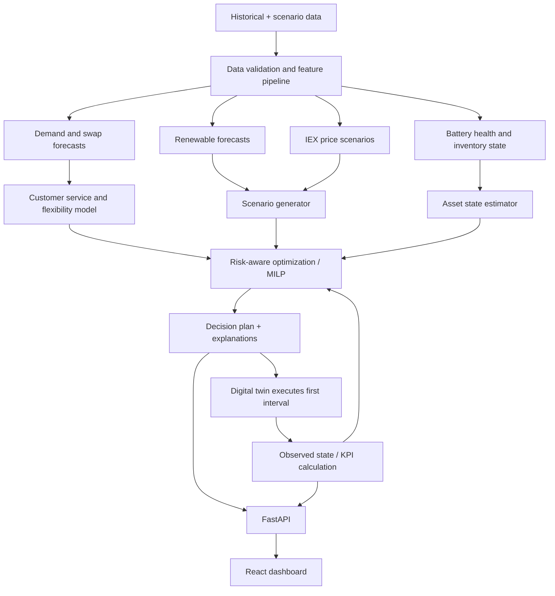

# VOLT — Technical Specification v1.0

**Virtual Orchestration of Load, Tariffs & Energy**  
**Project type:** Hackathon prototype / decision-support digital twin  
**Specification status:** v1.0 — build baseline  
**Date:** 22 November 2026  
**Primary currency:** INR  
**Initial operating horizon:** Rolling 24 hours  
**Initial decision interval:** 1 hour

---

## 0. Executive decision

Build **VOLT**, a multi-city, service-aware energy orchestration platform for an EV fast-charging and battery-swapping operator. VOLT jointly schedules energy procurement, stationary storage, swap-pack charging/inventory, customer charging flexibility and customer tariffs. It forecasts uncertainty, solves a constrained optimization problem, executes the first time step in a digital-twin simulation, observes the resulting state, and re-optimizes.

The project must not be presented as “a novel XGBoost + MILP model.” Forecasting, stochastic optimization, battery degradation-aware scheduling, demand response and integrated transport-power models already exist in the literature. Our defensible differentiation is the **end-to-end, auditable coupling** of:

1. customer service commitments and flexible charging windows;
2. separate physical models for stationary storage and swappable battery inventory;
3. risk-aware multi-cluster energy procurement and dispatch;
4. tariff/incentive recommendations constrained by the case limits; and
5. an interactive digital twin that compares operating policies under the same disturbance and reports feasibility, reliability, cost and EBITDA transparently.

The hackathon result is a decision-support prototype, not a live grid controller or an authorized IEX bidding system.

## 1. Case-study facts to preserve

The following values are taken from the supplied case-study screenshots. They are not assumptions.

| Item | Case value / wording | Implementation treatment |
|---|---|---|
| Network | Five metro clusters: Delhi NCR, Mumbai MMR, Bengaluru, Hyderabad, Chennai | Model as five independent operational clusters, coordinated by one optimizer |
| Installed capacity | 1,200 MW combined | System-wide installed power-capacity parameter |
| Capacity mix | 60% DC fast-charging hubs; 40% battery-swap stations | Initial aggregate split: 720 MW and 480 MW respectively; city allocation is not supplied |
| Storage | 600 MWh combined stationary battery banks and swap-pack inventory | Keep stationary BESS energy and swap-pack energy/inventory as separate asset classes; split is unknown |
| Renewable sourcing | About 35% of energy sourced from solar and wind through open-access contracts | Treat as historical/portfolio sourcing share, not a requirement that every hour has 35% renewable output |
| Other procurement | Remaining energy bought from DISCOMs and IEX Day-Ahead Market | Model as separately priced supply sources with configured availability and limits |
| Decisions | Procurement and charge/discharge decisions made hourly, aligned to IEX bidding windows | MVP decision interval is hourly; preserve 15-minute market-data granularity in the adapter |
| Current reliability | 78% | Baseline reference value |
| Reliability goal | 15% increase relative to 78%; stated target 89.7% (about 90%) | Report 89.7% as the numerical target |
| Current energy storage/conversion losses | 10% | Baseline reference value |
| Loss target | 20% reduction from 10%; target 8% | Report 8% as target |
| Profitability | EBITDA margin above 12% across all clusters | Calculate per cluster and consolidated; do not hide loss-making clusters in a consolidated average |
| Currency / market | INR, IEX context | Store costs and tariffs in INR with explicit energy units |
| Historical data assumption | Five years of hourly weather, cluster charging demand, swap logs, IEX prices, renewable generation and battery SOH records | Build a common timestamped data model; synthetic data must be visibly labelled when used |
| Customer price guardrail | Market-determined dynamic price within ±20% of previous day’s average tariff | Enforce lower and upper bounds equal to 0.8× and 1.2× previous-day average tariff, by applicable tariff class |
| Reserve obligation | 5% of total capacity and swap-pack inventory remain uncommitted for priority fleet and emergency services | Reserve is a hard constraint, not an optional optimization preference |

### 1.1 Important interpretation rules

- The case gives a **combined 600 MWh** storage figure but does not give its split between stationary batteries and swap packs. Never silently assign the split as a fact.
- The case gives a 1,200 MW network capacity and a 60/40 modality share, but does not give the five cities’ individual capacities, grid import limits, charger counts or site-level topology.
- The case’s reliability wording combines “energy and swaps.” Report a case-aligned **energy-equivalent service reliability** and also report separate fast-charge fulfilment and swap fulfilment. Define the conversion explicitly to avoid double-counting.
- The case’s 35% renewable share is a portfolio description. Renewable energy availability is time- and location-dependent; it must be bounded by each cluster’s forecasted contracted generation.
- The 5% reserve must not be counted as schedulable capacity or inventory. Reserve energy/packs are protected for priority and emergency service.

## 2. Product objectives and non-goals

### 2.1 Product objectives

VOLT must:

1. forecast cluster-level fast-charging demand, swap demand, renewable availability and IEX price uncertainty;
2. represent customer requests using service windows, energy requirements, deadlines and priority classes;
3. distinguish stationary BESS dispatch from swap-pack charging and inventory transitions;
4. recommend cluster-level energy procurement from renewable contracts, DISCOMs and IEX;
5. schedule storage charging/discharging and swap-pack replenishment without violating physical constraints;
6. recommend customer tariffs/incentives within the ±20% rule;
7. preserve the 5% emergency reserve;
8. re-optimize as new observations arrive (rolling-horizon control); and
9. demonstrate performance against clear baselines under normal and disrupted conditions.

### 2.2 Non-goals for the hackathon MVP

- Do not submit real IEX bids, control DISCOM connections, or send dispatch commands to hardware.
- Do not claim physical power transfer between cities. City-level coordination is informational and commercial unless a real network connection supports transfer.
- Do not transfer battery packs between cities unless route, travel time, cost, compatibility and safe transport capacity are explicitly modelled.
- Do not assume all batteries are interchangeable or that swap packs can discharge into the grid.
- Do not claim that synthetic simulation results prove real-world performance.
- Do not use reinforcement learning in the first release merely to make the solution appear more advanced.

## 3. Research position and defensible differentiation

### 3.1 What is already established in the literature

The literature already includes: EV charging scheduling with uncertainty; demand response and incentive pricing; battery-swapping station scheduling; uncertain swapping-demand inventory management; battery degradation-aware operation; and integrated transport-power system optimization. Therefore, these individual methods are not VOLT’s novelty claim.

Examples:

- Si et al. (2025), *Optimal scheduling for electric vehicle charging: A review of methods, technologies, and uncertainty management*, reviews EV charging scheduling and uncertainty-management methods. DOI: https://doi.org/10.1016/j.est.2025.117500.
- *A review on electric vehicle charging station operation considering market dynamics and grid interaction* (Applied Energy, 2025) reviews market interaction, pricing, smart charging, MPC, reinforcement learning and optimization methods, and identifies gaps in pricing, uncertainty management and market design. DOI: https://doi.org/10.1016/j.apenergy.2025.126058.
- *An operational scheduling framework for Electric Vehicle Battery Swapping Station under demand uncertainty* (Energy, 2024) combines demand response, charging-mode/degradation effects and swapping-demand uncertainty in a two-stage stochastic model. DOI: https://doi.org/10.1016/j.energy.2023.130219.
- Wang, Hou and Guo (2024), *Inventory management of battery swapping and charging stations considering uncertainty*, studies battery inventory, initial states and uncertainty using a multi-scenario distributionally robust approach. DOI: https://doi.org/10.1016/j.ijepes.2023.109528.
- Oladigbolu et al. (2025), *A review on transport and power systems planning-operation integrating electric vehicles, energy storage, and other distributed energy resources*, identifies unresolved challenges around coupled transport/power modelling, user behaviour and queues, temporal/spatial alignment, data interoperability, scalability and validation. DOI: https://doi.org/10.1016/j.est.2025.118419.
- Zhang et al. (2025), *Objective-driven charging control and learning-based incentive pricing for demand response of electric vehicles*, explicitly studies driver demand-response status and learning-based incentive pricing. DOI: https://doi.org/10.1016/j.energy.2025.138804.

### 3.2 Gap-to-design map

These are practical gaps and integration challenges synthesized from the above literature, not claims that no prior work has ever addressed them.

| Practical gap | VOLT design response | How we demonstrate it |
|---|---|---|
| Mobility-service needs are often simplified relative to energy scheduling | Represent requests with arrival, deadline, energy, urgency, waiting tolerance and flexibility window | Show completed service, delay and unmet energy per customer class |
| Stationary storage and swap-pack inventory are easy to conflate in aggregated models | Use separate state equations, power limits, inventory counts and reserve rules | Display BESS SOC separately from ready / charging / unavailable swap packs |
| Forecasts are uncertain and disturbances can be correlated | Use correlated scenarios for demand, renewable output and price; use risk-aware rolling optimization | Replay identical normal, heatwave/cloud, market-shock and combined-shock scenarios against baselines |
| A least-cost schedule can harm service reliability or battery life | Penalize priority-weighted unserved service and internalize degradation cost | Ablation: run with and without customer service constraints and degradation cost |
| A dashboard can show predictions without showing operational causality | Every recommendation stores a reason code and contribution breakdown | “Why this decision?” panel: binding constraint, cost delta, reserve impact, service impact |
| Synthetic simulations can overstate impact | Separate observed, assumed and synthetic data; benchmark and run sensitivity analysis | Data provenance badges, repeatable seeds, confidence intervals and assumption register |

### 3.3 Our innovation statement

> VOLT is a service-aware, risk-sensitive orchestration and digital-twin framework that co-optimizes customer charging commitments, stationary storage, swap-pack inventory, procurement and tariffs across five metro clusters, while preserving emergency reserves and explaining every operational recommendation.

Do **not** claim that this is the first integrated EV energy optimizer. Claim that the prototype provides a coherent, auditable implementation of the above coupled decision workflow for the exact mixed fast-charge / battery-swap / IEX case.

## 4. System architecture



### 4.1 Engines

**A. Predictive Intelligence**
- Fast-charge energy demand by cluster and hour.
- Swap requests by cluster and hour (packs / swaps, not kWh only).
- Renewable energy availability by cluster and hour.
- IEX price forecast/scenario distribution.
- Forecast outputs include point estimate and uncertainty interval/quantiles.

**B. Customer Service & Flexibility Engine**
- Models a request’s feasible service window and non-deferrable requirements.
- Categorizes demand as critical, urgent, deadline-constrained or flexible.
- Calculates the amount of energy that may be rescheduled without violating a request’s deadline or maximum wait.
- Customer incentives are bounded by a configured response curve. The response curve is synthetic until calibrated with customer history.

**C. Battery Intelligence Engine**
- Stationary BESS: energy SOC, charge/discharge power, efficiency, SOC limits, cycle/degradation cost and reserve.
- Swap inventory: pack count, compatibility class, SOC band, SOH band, charging queue, unavailable/maintenance state, completed swaps and replenishment.
- A battery passport holds pack-level metadata. For optimization scale, pack decisions may be aggregated into cohorts (compatibility × SOH band × SOC band); the digital twin preserves individual pack IDs for visual traceability.

**D. Risk-aware Decision Engine**
- MILP or MILP-compatible linearized formulation.
- First version: deterministic MILP baseline plus scenario-based expected-cost/CVaR extension.
- Rolling horizon: optimize the next 24 hours, execute only the first interval, update observed state, and solve again.

**E. Digital Twin and Explainability**
- Simulates demand arrivals, direct charging, swap requests, pack charging, stationary BESS, renewable availability, grid procurement and service outcomes.
- Stores baseline and optimized runs under the same scenario seed.
- Every action has a reason code, objective-cost contribution and KPI impact.

## 5. Time, space, units and market alignment

### 5.1 Initial time model

- Optimization horizon: 24 hourly intervals.
- Simulation time step: 1 hour for MVP.
- All timestamps: ISO-8601 with timezone; use Asia/Kolkata for case operations.
- Inputs may contain IEX 15-minute data. The adapter must retain original blocks and create hourly aggregates for the MVP (energy-weighted prices/quantities where appropriate). Do not simply average MW with MWh or average price blocks without documenting the aggregation method.
- A later version can move to 15-minute rolling optimization without changing the data contracts.

IEX’s current DAM market snapshot reports 15-minute time blocks. IEX’s RTM page describes 48 sessions per day, auctions every half hour, and delivery one hour after market closure. See official sources in References.

### 5.2 Initial spatial model

- The five metro clusters are the main optimization nodes.
- No city-level capacity split is provided. Store city weights in configuration, not source code.
- For demo-only initialization, an equal 20% split may be used and visibly tagged `ASSUMPTION`; do not present it as company data.
- A cluster’s import limit, contracted renewable availability and charger capacity are independent parameters.
- Physical inter-city electricity transfer is disabled by default.
- Optional pack-transfer arcs require origin, destination, travel time, compatible pack type, transport capacity and cost. Disable until those inputs are provided.

### 5.3 Units

Use the following internal convention consistently:

| Quantity | Unit |
|---|---|
| Power / charger / grid limit | MW |
| Energy / BESS capacity / customer demand | MWh |
| Electricity market price | INR/MWh |
| Retail charging tariff | INR/kWh |
| Swap price | INR/swap |
| Battery SOC / SOH / efficiency / reliability | fraction (0–1) |
| Pack inventory | packs |
| Degradation | INR/MWh-throughput or pack-specific INR/cycle equivalent |
| Time | hour |

Conversion rule: 1 MWh = 1,000 kWh. Convert retail tariff revenue consistently: `INR/kWh × kWh`.

## 6. Data model and provenance

### 6.1 Required tables / logical entities

| Entity | Primary fields | Notes |
|---|---|---|
| `cluster` | `cluster_id`, `name`, `timezone`, `installed_power_mw`, `fast_charge_share`, `swap_share`, `grid_import_limit_mw` | Five required clusters; unknown capacities remain configurable |
| `station` | `station_id`, `cluster_id`, `station_type`, `charger_count`, `charger_power_mw`, `swap_compatibility_groups`, `location_optional` | Site data may be synthetic for MVP |
| `hourly_demand_forecast` | `timestamp`, `cluster_id`, `fast_charge_mwh_p50/p10/p90`, `swap_requests_p50/p10/p90`, `source` | Store both forecast and actual separately |
| `customer_request` | `request_id`, `cluster_id`, `service_type`, `arrival_time`, `deadline`, `energy_required_mwh`, `pack_type`, `priority`, `max_wait_hours`, `flexible_flag`, `source` | Use request-level records for simulation; forecasts can be aggregated |
| `renewable_forecast` | `timestamp`, `cluster_id`, `solar_mwh_available`, `wind_mwh_available`, `contracted_mwh`, `uncertainty_scenario`, `source` | Available energy is bounded by contract and forecast |
| `market_price` | `timestamp`, `market`, `price_inr_mwh`, `block_minutes`, `cleared_volume_mw`, `source` | IEX data adapter; retain original 15-minute blocks |
| `procurement_contract` | `cluster_id`, `source_type`, `max_mw`, `price_inr_mwh`, `take_or_pay`, `curtailment_penalty`, `valid_from`, `valid_to` | Renewable/discom terms must be configurable |
| `bess_asset` | `asset_id`, `cluster_id`, `capacity_mwh`, `max_charge_mw`, `max_discharge_mw`, `eta_charge`, `eta_discharge`, `soc_min`, `soc_max`, `initial_soc`, `degradation_curve_id` | Power rating and 600 MWh split are unknown; do not derive them silently |
| `battery_pack` | `pack_id`, `cluster_id`, `compatibility_group`, `nominal_capacity_kwh`, `soc`, `soh`, `cycle_count`, `temperature_optional`, `status`, `charging_power_kw` | Pack-level state for digital twin; cohort aggregation for solver |
| `tariff` | `cluster_id`, `service_type`, `effective_date`, `previous_day_avg_inr_kwh`, `min_price`, `max_price`, `recommended_price` | min/max = 0.8/1.2 × previous-day average |
| `operating_cost` | `cluster_id`, `timestamp`, `cost_type`, `amount_inr`, `accounting_treatment` | Separates EBITDA expenses from lifecycle economic costs |
| `scenario` | `scenario_id`, `name`, `probability`, `seed`, `weather_profile`, `demand_multiplier`, `price_multiplier`, `renewable_multiplier`, `grid_event` | Scenarios can be deterministic for reproducible demo |
| `optimization_run` | `run_id`, `scenario_id`, `model_version`, `solver_status`, `objective_inr`, `solve_time_seconds`, `created_at` | Record infeasible / time-limit statuses explicitly |
| `decision` | `run_id`, `cluster_id`, `timestamp`, `decision_type`, `quantity`, `unit`, `reason_code`, `binding_constraint` | Explainability and audit trail |
| `kpi_result` | `run_id`, `cluster_id`, `kpi_name`, `value`, `unit`, `baseline_value`, `target_value` | Per cluster and consolidated |

### 6.2 Data provenance rules

Every input row or generated series must carry one of:
- `OBSERVED`: supplied or downloaded real data with source and retrieval date;
- `ASSUMED`: explicit configurable modelling assumption;
- `SYNTHETIC`: generated for simulation; seed and generator version recorded.

The UI must visibly distinguish these. Never present synthetic values as historical company records.

## 7. Forecasting specification

### 7.1 Targets

1. `fast_charge_mwh`: hourly delivered energy demand by cluster.
2. `swap_requests`: number of swap requests by cluster and compatible pack group.
3. `renewable_mwh_available`: hourly available contracted solar/wind generation by cluster.
4. `iex_price_inr_mwh`: hourly-aggregated price forecast for the MVP, preserving original market blocks.

### 7.2 Candidate models

Start with strong tabular baselines:
- Seasonal-naive baseline (same hour previous week / previous day as appropriate).
- LightGBM or CatBoost with lag, calendar, weather and cluster features.
- Quantile models for P10/P50/P90 demand and renewable forecasts.
- IEX price: seasonal-naive + LightGBM/quantile regression baseline.

Do not assume deep learning will be superior on the available dataset. Compare against baselines using time-ordered backtesting, never random train/test splitting for time series.

### 7.3 Features

- Lagged demand (1h, 24h, 168h), rolling means and standard deviations.
- Hour of day, day of week, month, holiday/event indicators.
- Temperature, humidity, rainfall, cloud cover, solar irradiance, wind speed where available.
- Historical queue/wait, station utilization, fleet schedules, swap requests and pack availability.
- IEX recent prices, time-block/seasonality features and market-day flags.
- Cluster and station characteristics.

### 7.4 Evaluation

- Demand / renewable: MAE, RMSE, WAPE and quantile pinball loss.
- Price: MAE, RMSE, WAPE; separately report price-spike detection precision/recall if implemented.
- Backtest: chronological rolling-origin evaluation; reserve the final period as untouched test data.
- Report errors by city and by peak/off-peak period, not only one aggregate score.

## 8. Customer-service and flexibility formulation

Represent a charging request `i` with:
- cluster `c(i)`;
- arrival time `a_i`;
- departure deadline `d_i`;
- required energy `E_i` (MWh) or swap requirement `n_i` (packs);
- service priority `w_i`;
- maximum waiting time `W_i`;
- compatible connector / pack group;
- allowed service intervals `T_i`;
- flexibility class and incentive response curve.

For direct charging, allocate `x[i,t]` MWh to request `i` during interval `t` only when `t` is inside its allowed window. Enforce total delivered energy by the deadline, charging-power limits and customer-specific constraints. If infeasible, use an explicit unmet-energy slack variable `u_i` with a priority-weighted penalty; do not silently drop the request.

For swaps, the request is served only when a compatible ready pack is available and swap-station service capacity is available. A completed swap contributes a documented energy-equivalent amount to the case reliability KPI, but the pack’s later recharge is a separate energy consumption event. Do not count the same energy twice.

### 8.1 Flexibility policy

- Critical / emergency: no voluntary deferral; highest unmet-service penalty.
- High urgency: small permitted delay, no incentive assumption unless data supports it.
- Deadline-constrained fleet: may shift within the customer’s declared arrival/departure window.
- Flexible retail: wider window if the customer opts in.

Use incentives only for genuinely shiftable demand. The incentive response curve is a configurable model, not a fact. First release may use discrete customer willingness tiers (e.g., accept / reject at configured incentive levels) generated from synthetic data. Clearly label this as synthetic until calibrated from historical response logs.

## 9. Battery and storage specification

### 9.1 Stationary BESS

For cluster `c`, hour `t`:

`SOC[c,t+1] = SOC[c,t] + eta_ch[c] * P_ch[c,t] * dt / E_cap[c] - P_dis[c,t] * dt / (eta_dis[c] * E_cap[c])`

Equivalent energy-state formulation is preferred in code to avoid unnecessary division. Enforce:
- `E_min <= E[c,t] <= E_max`;
- `0 <= P_ch[c,t] <= P_ch_max[c]`;
- `0 <= P_dis[c,t] <= P_dis_max[c]`;
- no simultaneous charging and discharging (binary mode or an equivalent valid formulation);
- reserve energy unavailable to ordinary dispatch;
- efficiency and degradation costs from configuration.

Do not invent a BESS power rating from its MWh capacity. The 600 MWh is a combined energy figure and does not determine MW power capability.

### 9.2 Swap-pack inventory

A swap pack is a mobility-service asset, not automatically a grid battery. Its energy is replenished from the station’s electrical supply and issued to a customer as a pack. Do not discharge it into the grid in the base model.

Maintain at least these pack states:
- ready / charged;
- charging;
- waiting for charge / depleted;
- unavailable / maintenance;
- reserved for priority / emergency service.

Inventory transition (conceptual):

`ready[t+1] = ready[t] + charge_completions[t] - completed_swaps[t] + transfers_in[t] - transfers_out[t]`

All counts must be integer and compatibility-aware. Pack charging energy must account for starting SOC, target SOC, capacity and charging efficiency. Charging power is bounded by station charger capacity. SOH should affect usable capacity and degradation cost; packs below configured safety/service thresholds should not be counted as serviceable inventory.

For optimization, aggregate packs into cohorts defined by compatibility group × SOH band × SOC band if individual-pack MILP becomes too large. The digital twin can preserve individual pack records and apply a transparent pack-selection rule.

### 9.3 Degradation economics

Include a degradation cost in the optimizer based on throughput/cycle depth and SOH band. Because the case gives SOH records but not the chemistry-specific degradation curve, the curve is a configurable assumption and must be sensitivity-tested.

Report two concepts separately:
1. **EBITDA margin:** accounting-style operating margin using explicitly configured revenue and operating expense categories.
2. **Degradation-adjusted economic contribution:** EBITDA less an estimated lifecycle/degradation reserve, reported as a supplemental decision metric.

Do not automatically subtract a non-cash modeled battery replacement reserve from EBITDA without specifying its accounting treatment.

## 10. Energy procurement and balance

For each cluster and time interval, balance available electrical energy against direct charging, swap-pack charging, stationary storage charging, auxiliary load, exports (disabled by default) and losses.

A simplified power balance is:

`P_renewable_used + P_DISCOM + P_IEX + P_BESS_discharge = P_fast_charge_input + P_swap_charge_input + P_BESS_charge + P_aux + P_export + P_network_loss`

Use MW for power in each interval and convert to MWh with `dt`. Charging output delivered to vehicles is lower than grid input when charger/conversion efficiency is below 100%. BESS charge/discharge efficiency must be represented once, not double-counted in the balance.

Procurement rules:
- Renewable supply is capped by forecasted contracted availability.
- DISCOM purchase is bounded by configured agreement / grid import capacity.
- IEX procurement is an optimization recommendation with market price and time-block data.
- Add renewable take-or-pay or curtailment penalties only if contract terms are known/configured.
- Selling/exporting surplus is disabled unless an explicit contract/market participation flag is enabled.
- The model may recommend quantities and price limits for bids; it does not submit bids.

IEX market note: the official IEX DAM snapshot currently exposes 15-minute blocks. IEX’s RTM product page describes 48 daily sessions, half-hourly auctions and delivery one hour after closure. The case’s hourly control interval is therefore an MVP simplification; keep the ingestion layer finer-grained so the model can be upgraded.

## 11. Optimization formulation

### 11.1 Sets and indices

- `c ∈ C`: five metro clusters.
- `t ∈ T`: hourly intervals in rolling horizon.
- `s ∈ S`: uncertainty scenarios.
- `i ∈ I`: customer requests / request cohorts.
- `b ∈ B_c`: stationary BESS assets in cluster `c`.
- `g ∈ G`: procurement sources (renewable, DISCOM, IEX).
- `k ∈ K`: swap-pack compatibility / SOH / SOC cohorts.

### 11.2 Core decisions

- `q[c,g,t,s]`: power purchased from source `g`.
- `p_ch[c,b,t,s]`, `p_dis[c,b,t,s]`: BESS charging/discharging power.
- `e[c,b,t,s]`: BESS energy state.
- `x[i,t,s]`: direct charging energy allocated to request `i`.
- `u[i,s]`: unmet request energy / service slack.
- `z[c,k,t,s]`: number of swap requests fulfilled from pack cohort `k`.
- `n_ready[c,k,t,s]`, `n_charging[c,k,t,s]`: inventory states.
- `r[c,t,s]`: customer tariff recommendation.
- `m[c,t,s]`: incentive / demand-shift decision.
- Optional `bid_qty` and `bid_price_limit` for IEX recommendation (not execution).

### 11.3 Objective

Minimize risk-adjusted expected operating cost while valuing customer service and commercial contribution:

`min  E_s[ C_energy + C_incentives + C_variable_O&M + C_degradation + C_unserved + C_curtailment + C_imbalance ] + lambda_CVaR * CVaR_alpha(total_cost_s)`

Where:
- `C_energy`: renewable, DISCOM and IEX procurement cost;
- `C_incentives`: customer flexibility payments;
- `C_variable_O&M`: variable operations expenses;
- `C_degradation`: modeled lifecycle wear cost, separate from EBITDA accounting;
- `C_unserved`: priority-weighted penalty for unmet charge/swap service;
- `C_curtailment`: only if contract economics justify it;
- `C_imbalance`: only where a measurable schedule/imbalance charge is configured;
- `CVaR_alpha`: tail-risk measure (initially test alpha = 0.95; tune lambda using sensitivity analysis).

The service penalty must be large enough that the model does not save a small amount on energy by abandoning critical customers. Use a lexicographic or penalty-calibration test: critical service first, then feasibility/reserve, then economics. Do not rely on arbitrary huge constants without validating solver numerical stability.

### 11.4 Mandatory constraint families

1. **Energy balance:** source power + BESS discharge equals all electrical loads + BESS charging + losses, per cluster and interval.
2. **Source limits:** renewable availability, DISCOM import limits, IEX procurement limits and system grid limit.
3. **Capacity allocation:** total charging/swap station power cannot exceed the applicable installed capacity and configured city split.
4. **Stationary BESS dynamics:** SOC bounds, power bounds, efficiencies, initial/final condition, no simultaneous charge/discharge.
5. **Swap inventory dynamics:** ready, charging, depleted and unavailable pack counts; integer pack service; charger throughput; compatibility; reserve.
6. **Customer requests:** arrival/deadline windows, energy requirement, max service rate, wait bound, priority and explicit unmet-service slack.
7. **Reserve obligation:** at least 5% of applicable capacity and swap inventory remains uncommitted. Define whether reserve applies to each cluster or system total based on case interpretation; conservative MVP should enforce the 5% at both cluster and network level where the asset data supports it.
8. **Tariff guardrail:** `0.8 * previous_day_avg_tariff[c,class] <= r[c,class,t] <= 1.2 * previous_day_avg_tariff[c,class]`.
9. **Tariff continuity / fairness:** optional bound on hour-to-hour changes and exclusion of critical emergency customers from surge pricing.
10. **Renewable contract constraints:** available energy and any known take-or-pay/curtailment terms.
11. **End-of-horizon state:** prevent the optimizer from emptying batteries or swap inventory at the end of the 24-hour horizon by imposing terminal SOC/inventory floors or a terminal value.
12. **Per-cluster viability:** report margin and service feasibility per cluster; do not allow a profitable cluster to conceal a failing cluster.

### 11.5 Customer pricing and incentives

Price is bounded by the case tariff rule. The MVP should not assume a known price elasticity. Implement one of these clearly labelled paths:

- **MVP path:** a transparent scarcity/congestion pricing heuristic within the ±20% bounds, with incentives applied only to opted-in flexible cohorts; or
- **Optimization path:** a piecewise-linear demand-response curve calibrated from historical price/acceptance observations, with acceptance probability and incentive cost included in the optimization.

Do not invent precise elasticity coefficients and report them as learned facts. If using synthetic coefficients, expose them in the assumption file and run low/base/high elasticity sensitivity tests.

### 11.6 Risk/scenario model

Initial scenario set:
- `NORMAL`: typical demand, renewable output and IEX prices.
- `DEMAND_PEAK`: demand spike / heat-driven demand.
- `RENEWABLE_DROP`: cloud cover or wind lull.
- `IEX_PRICE_SPIKE`: market price surge.
- `COMBINED_CRISIS`: correlated demand spike + renewable drop + price spike + lower swap inventory.

Use an explicit scenario probability or a stress-test mode. For data-driven scenarios, sample joint residuals (not each variable independently) to preserve observed correlations. MVP scenario probabilities are assumptions, not calibrated probabilities. In stress-test mode, do not average away the worst case; show each scenario’s result separately.

### 11.7 Rolling Model Predictive Control

At each simulated hour:
1. read the observed asset/customer state;
2. update forecasts and scenario tree for the next 24 hours;
3. solve the optimization problem;
4. validate the solver status and all hard constraints;
5. publish the recommended plan and explanation;
6. execute the first hour in the digital twin only;
7. record the actual simulated outcome and update states;
8. re-optimize next hour.

If optimization is infeasible or times out, fall back to a documented safe heuristic: protect reserves, serve critical requests, maintain physical limits, and report the fallback reason. Never present an unverified schedule as an optimal solution.

## 12. KPI definitions

### 12.1 Case-aligned service reliability

`Reliability = 100 × served_energy_equivalent_MWh / forecast_energy_equivalent_demand_MWh`

For direct charging, served energy-equivalent is metered energy delivered to the customer. For a completed swap, energy-equivalent is the usable energy of the compatible pack issued to the customer, counted once. This creates a common unit for the case KPI.

Also report:
- fast-charge request fulfilment (% energy and % sessions);
- swap request fulfilment (% packs / requests);
- realized-demand service fill rate (served realized request energy-equivalent / actual realized request energy-equivalent);
- average and P95 wait time;
- unmet service by priority class.

Because the case denominator says *forecasted demand*, preserve that case-aligned KPI but do not use it as the sole operational service metric. If forecast is biased low, the ratio can be misleading.

### 12.2 Energy loss ratio

`Loss ratio = 100 × metered_storage_conversion_distribution_losses_MWh / gross_energy_input_MWh`

Include charger conversion losses, BESS round-trip losses, swap-pack charge losses, idle-pack self-discharge and distribution losses. Assign each loss to exactly one meter boundary to avoid double counting. Report the components individually and reconcile the total.

### 12.3 EBITDA margin

`EBITDA margin[c] = 100 × (revenue[c] - EBITDA_operating_expenses[c]) / revenue[c]`

Revenue and operating expense categories must be configured transparently. At minimum, include charging revenue, swap revenue, electricity procurement cost, variable O&M and applicable operating expenses. If fixed overhead, employee cost, rent or market fees are unavailable, label EBITDA as an **illustrative operating-margin proxy**, not audited EBITDA.

Report:
- per-cluster EBITDA margin;
- consolidated EBITDA margin;
- revenue and cost breakdown;
- degradation-adjusted economic contribution as a separate supplemental metric.

### 12.4 Forecast and solver KPIs

- Forecast MAE / RMSE / WAPE / quantile pinball loss.
- Optimization solve time (median, P95), gap if available, status, infeasible-run count.
- Constraint violation count: must be zero for every published feasible plan.
- Reserve utilization: reserved assets must remain uncommitted in normal dispatch.
- Renewable utilization / curtailment.
- BESS equivalent full cycles and degradation cost.
- Swap pack stock-out hours and ready inventory.

## 13. Digital-twin benchmark design

### 13.1 Policies to compare

1. **Baseline / business-as-usual:** static allocation and simple charging policy calibrated to the case baseline KPI references (78% reliability and 10% losses). Do not force the optimized policy to hit targets.
2. **Greedy price-only heuristic:** charge/dispatch based on current price and SOC, without customer flexibility or risk scenarios.
3. **Deterministic MILP:** full physical constraints but point forecasts only.
4. **VOLT proposed:** customer-service-aware, degradation-aware, scenario-based rolling MILP with flexibility and tariff recommendations.

If the exact existing operating policy is unavailable, label policy 1 as a **reconstructed baseline**, not the operator’s actual algorithm.

### 13.2 Required scenario experiments

- Normal day.
- City-specific peak in each of the five clusters.
- Renewable generation drop.
- IEX price spike.
- Sudden swap pack stock-out.
- Combined crisis.
- Recovery after crisis.

Run all policies with identical scenario seeds and input conditions.

### 13.3 Ablation tests

Remove one capability at a time from VOLT:
- no customer flexibility;
- no battery degradation cost;
- no CVaR / scenario risk term;
- no dynamic tariff/incentive module;
- aggregate swap inventory instead of compatibility/SOH cohorts.

This identifies which modules actually drive improvements. It also protects us from claiming that a feature helps when the simulation does not support the claim.

### 13.4 Acceptance targets for the hackathon prototype

- Runs all five clusters for at least 24 hours and supports multi-day batch evaluation.
- Feasible schedules obey all hard constraints and the 5% reserve.
- Customer tariff recommendations always remain within 80–120% of previous-day average tariff.
- Swap inventory never goes negative; only compatible ready packs fulfil swaps.
- Stationary BESS and swap-pack energy are never conflated.
- Repeated run with the same seed and model version produces the same simulation inputs and reproducible outputs (within solver tolerance).
- Every result clearly labels observed / assumed / synthetic data.
- Dashboard can compare at least four policies and five scenario types.
- Every recommendation provides a human-readable reason and identifies the binding constraint or trade-off.
- The app reports infeasibility/fallback explicitly rather than fabricating a schedule.

The 89.7% reliability, 8% loss and >12% per-cluster EBITDA are **business targets**, not software acceptance guarantees. Whether they can all be achieved must be demonstrated through the model and sensitivity tests.

## 14. Software architecture and repository layout

Recommended monorepo:

```text
volt/
├── README.md
├── SPEC.md
├── pyproject.toml
├── .env.example
├── docker-compose.yml
├── configs/
│   ├── case_study.yaml
│   ├── assumptions.yaml
│   ├── scenarios.yaml
│   └── model.yaml
├── data/
│   ├── raw/                 # gitignored; user-supplied files only
│   ├── processed/           # gitignored
│   └── synthetic/           # generated and provenance-labelled
├── backend/
│   ├── app/
│   │   ├── main.py
│   │   ├── api/routes/
│   │   ├── schemas/
│   │   ├── services/
│   │   └── db/
│   └── tests/
├── engine/
│   ├── data/                # loaders, validators, feature pipeline
│   ├── forecasting/         # baselines, ML, evaluation
│   ├── scenarios/           # correlated scenario generation
│   ├── customer/            # requests and flexibility envelopes
│   ├── batteries/           # BESS and swap-pack state models
│   ├── optimization/        # Pyomo formulation, solver adapter
│   ├── control/             # MPC loop and fallback policy
│   ├── simulation/          # discrete-event / hourly digital twin
│   ├── metrics/             # KPI calculations
│   └── tests/
├── frontend/
│   ├── src/
│   └── tests/
├── scripts/
│   ├── generate_synthetic_data.py
│   ├── run_backtest.py
│   └── run_scenario.py
├── reports/
│   ├── experiment_results/
│   └── figures/
└── docs/
    ├── data_dictionary.md
    ├── assumptions_register.md
    └── api_contracts.md
```

### 14.1 API shape (initial contract)

- `GET /api/v1/health`
- `GET /api/v1/config/case`
- `GET /api/v1/clusters`
- `GET /api/v1/scenarios`
- `POST /api/v1/simulations` — start a synchronous MVP run or return a run ID for background execution later.
- `GET /api/v1/simulations/{run_id}`
- `GET /api/v1/simulations/{run_id}/kpis`
- `GET /api/v1/simulations/{run_id}/decisions`
- `GET /api/v1/simulations/{run_id}/timeseries`
- `POST /api/v1/optimizations/preview` — validate input and return a proposed schedule; never submit real market bids.

Use Pydantic schemas at API boundaries. Keep optimization logic independent of FastAPI and the frontend.

## 15. Technology choices

| Layer | Choice | Reason |
|---|---|---|
| Language | Python 3.11+ | Data, ML and optimization ecosystem |
| Data | Pandas / NumPy / Parquet | Practical tabular and time-series processing |
| ML | LightGBM or CatBoost | Strong tabular baselines; compare before choosing |
| Optimization | Pyomo | Explicit, readable mathematical model |
| Solver | HiGHS first; optional commercial solver if available | Reproducible MILP solver path |
| Simulation | Python discrete-event / hourly state simulation | Keeps initial model auditable and testable |
| API | FastAPI + Pydantic | Typed service boundary |
| Database | PostgreSQL | Run metadata, scenario data and decisions |
| Frontend | React + TypeScript | Interactive judge-facing dashboard |
| Charts | Recharts | KPI, time-series and policy comparison visualizations |
| Local environment | Docker Compose | Reproducible backend/database development |

## 16. Implementation sequence

### Phase 0 — Specification and assumptions (this document)
Freeze the model boundary, units, KPI definitions, data provenance and non-goals.

### Phase 1 — Repository foundation
Create the monorepo, config files, typed schemas, API health endpoint, database placeholder, basic React shell, Docker Compose, lint/test setup and a smoke test. No unverified optimization logic yet.

### Phase 2 — Data layer and digital-twin baseline
Generate reproducible synthetic five-city data; validate energy units; implement baseline policy; calibrate reference KPI definitions without hard-coding the proposed policy’s success.

### Phase 3 — Forecasting
Implement seasonal-naive and LightGBM/CatBoost baselines; time-series backtesting; quantile forecasts; export forecast scenarios.

### Phase 4 — Physical simulation
Implement power balance, BESS SOC, swap-pack inventory and customer requests as independently tested state transitions.

### Phase 5 — Optimization
Build deterministic MILP first; unit-test constraints; add customer flexibility; add degradation; add risk scenarios/CVaR; add tariff recommendations.

### Phase 6 — MPC integration
Reforecast, reoptimize and execute one interval per loop; add safe fallback for infeasible/time-limited solves.

### Phase 7 — Dashboard and explainability
Connect run APIs, scenario controls, policy comparisons, maps only if station coordinates are supplied, KPI views, decision timeline and “why this decision?” explanation.

### Phase 8 — Validation and pitch
Run benchmarks, ablations, sensitivity tests, compute confidence intervals and prepare a reproducible evidence pack. Do not report targets as achieved until actual runs demonstrate them.

## 17. Assumptions register — defaults must be editable

Create a YAML assumption register with these fields. The numerical defaults used for synthetic data are modelling placeholders, not case facts.

| Parameter | Why needed | Default policy |
|---|---|---|
| City capacity shares | No allocation by city in case | Equal 20% only for demo, tagged ASSUMED; allow user override |
| 600 MWh split: BESS vs swap packs | Case only gives combined capacity | Must be configurable; choose a transparent demo split and sensitivity-test it |
| BESS charge/discharge MW | MWh does not determine power | Configurable per asset; never infer solely from capacity |
| BESS efficiencies and SOC bounds | Needed for dynamics | Configurable illustrative values with sensitivity ranges |
| Swap pack capacity / compatibility | No pack specs | Generate multiple configurable pack classes; label SYNTHETIC |
| Battery degradation curve | Chemistry and warranty curve absent | Configurable piecewise-linear curve; label ASSUMED |
| Customer arrival / deadline distribution | No request-level records supplied | Synthetic fleet/customer profiles with seeded generator |
| Customer flexibility / incentive response | No elasticity or opt-in data supplied | Synthetic discrete response tiers; test low/base/high response |
| City grid import caps | Not supplied | Configurable; cannot exceed case’s installed system capacity |
| Renewable contract profile and curtailment terms | 35% portfolio share but no hourly contract details | Synthetic profile bounded by configured contract; do not invent take-or-pay penalty |
| DISCOM tariff and IEX procurement limits | Not supplied | Configurable scenario parameters; keep units and sources explicit |
| EBITDA expense structure | Full accounting data unavailable | Label as operating-margin proxy until all expense categories are supplied |
| Pack transfer network | No route/logistics data | Disabled by default |

Every parameter must contain `value`, `unit`, `provenance`, `rationale`, and (where relevant) `low`, `base`, `high` sensitivity values.

## 18. Risk register

| Risk | Consequence | Mitigation |
|---|---|---|
| Synthetic data presented as real | Loss of credibility | Provenance label on every chart/export; cite all external datasets |
| Infeasible optimization | Demo fails or false schedule shown | Hard-constraint tests, solver-status validation, safe fallback policy |
| Incorrect mixing of MW and MWh | Invalid energy balance | Centralized unit conversions and unit tests |
| Stationary storage conflated with swap inventory | Physically invalid decisions | Separate state models and APIs |
| Arbitrary elasticity assumptions | Fake customer-response claims | Configurable response tiers, sensitivity analysis, calibration caveat |
| 600 MWh split invented | Misleading asset deployment | Assumption register and adjustable scenario inputs |
| City-to-city transfer implied without network | Impossible dispatch | No physical electricity transfer; optional pack logistics only with route constraints |
| EBITDA incorrectly calculated | False profitability claims | Accounting categories and operating-margin proxy label |
| Point forecasts hide tail risks | Shortages during disruptions | Correlated scenarios, stress tests and CVaR |
| Solver too slow | No real-time demonstration | Start with hourly MILP, aggregate pack cohorts, benchmark solve time, add fallback |
| IEX execution implied | Regulatory/operational overclaim | Recommendations only; market participation is outside prototype scope |

## 19. References and evidence base

1. Si, C., Chau, K. T., Liu, W., & Hou, Y. (2025). “Optimal scheduling for electric vehicle charging: A review of methods, technologies, and uncertainty management.” *Journal of Energy Storage*, 131, 117500. https://doi.org/10.1016/j.est.2025.117500
2. “A review on electric vehicle charging station operation considering market dynamics and grid interaction.” *Applied Energy* (2025), 392, 126058. https://doi.org/10.1016/j.apenergy.2025.126058
3. “An operational scheduling framework for Electric Vehicle Battery Swapping Station under demand uncertainty.” *Energy* (2024), 290, 130219. https://doi.org/10.1016/j.energy.2023.130219
4. Wang, Z., Hou, S., & Guo, W. (2024). “Inventory management of battery swapping and charging stations considering uncertainty.” *International Journal of Electrical Power & Energy Systems*, 155, 109528. https://doi.org/10.1016/j.ijepes.2023.109528
5. Oladigbolu, J., Bakare, M. S., Motlagh, S. G., Mujeeb, A., & Li, L. (2025). “A review on transport and power systems planning-operation integrating electric vehicles, energy storage, and other distributed energy resources.” *Journal of Energy Storage*, 135, 118419. https://doi.org/10.1016/j.est.2025.118419
6. Zhang, K., Xu, Y., Sun, H., & Tai, N. (2025). “Objective-driven charging control and learning-based incentive pricing for demand response of electric vehicles.” *Energy*, 338, 138804. https://doi.org/10.1016/j.energy.2025.138804
7. Indian Energy Exchange (IEX). “Day Ahead Market — Market Snapshot.” Official market-data page: https://www.iexindia.com/market-data/day-ahead-market/market-snapshot
8. Indian Energy Exchange (IEX). “Real Time Market.” Official product page: https://www.iexindia.com/products/real-time-market
9. Government of India, Ministry of Power. “Guidelines for Installation and Operation of Battery Swapping and Battery Charging Stations,” Office Memorandum dated 10 January 2025, reproduced in Rajya Sabha answer on 3 February 2025: https://sansad.in/getFile/annex/267/AU156_NLNp8T.pdf?source=pqars
10. CEEW, IBSA and CII (2026). “Scaling Battery Swapping for India’s EV Ambitions: Market Challenges and Policy Opportunities,” 30 June 2026: https://www.ceew.in/publications/challenges-and-benefits-of-battery-swapping-system-policies-for-electric-vehicle-transition-india

---

**Specification owner’s rule:** No model result is accepted until it is physically feasible, reproducible, provenance-labelled, and evaluated against a named baseline under identical conditions.
