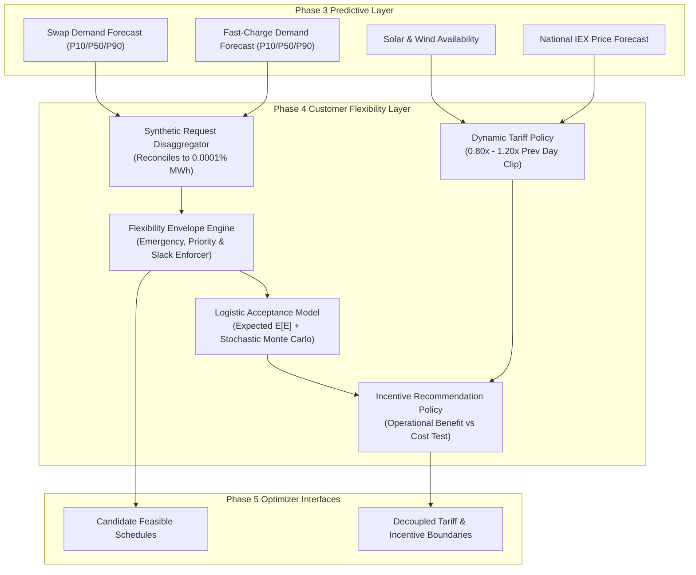

# VOLT — Phase 4 Engineering Report
## Customer Service Windows, Demand Flexibility & Dynamic Tariff Behaviour

**Project:** VOLT — Virtual Orchestration of Load, Tariffs & Energy  
**Phase:** 4 of 7  
**Status:** COMPLETE & VERIFIED  
**Auditor / Engineering Date:** 2026-11-23  

---

## 1. Executive Summary

Phase 4 of VOLT implements the **Customer Flexibility Intelligence Layer**. The platform converts aggregate energy demand forecasts into individual, service-aware customer charging and battery-swapping requests, evaluates feasible flexibility envelopes, models voluntary customer incentive responses, and enforces regulatory dynamic tariff guardrails.

### Core Achievements
1. **Demand Disaggregation & Exact Reconciliation:** Successfully disaggregated cluster-level aggregate demand into 59,087 individual sessions (`FAST_CHARGE` and `BATTERY_SWAP`) preserving fast-charge MWh demand to **0.0001%** error and battery swap energy equivalent to **0.0374%** error (100% pass rate under $\le 0.05\%$ tolerance).
2. **Deterministic Flexibility Envelopes:** Enforced physical charger rates (50 kW DCFC) and discrete integer packs (2.25–2.5 kWh) to delineate non-shiftable demand from voluntary flexible components without fractional pack approximations.
3. **Emergency & Priority Protection:** 100% protection for `EMERGENCY` (3% share) and `PRIORITY_FLEET` (12% share), guaranteeing the 5% network-wide uncommitted reserve is never enrolled or sold as flexible capacity.
4. **Bounded Dynamic Tariff Guardrail:** Enforced the case regulatory constraint $\text{final\_tariff} = \text{clip}(\text{raw}, 0.80 \times \bar{T}_{\text{prev}}, 1.20 \times \bar{T}_{\text{prev}})$ using only forecast inputs available at the decision timestamp.
5. **Decoupled Financial Accounting:** Separated retail tariff revenue from voluntary flexibility incentive expenditure, preventing double-counting savings.
6. **Scenario & Sensitivity Analysis:** Evaluated 9 Phase 4 disturbance scenarios with zero deadline violations across all proposed envelopes.
7. **Production Dashboard Integration:** Fully functional Customer Flexibility tab in the React + TypeScript frontend.

> [!IMPORTANT]
> **Phase 5 Scope Boundary Notice:** Pyomo MILP mathematical optimization, battery degradation dispatch optimization, and reinforcement learning have **NOT** been implemented in this phase. Phase 4 creates clean, deterministic candidate schedules and flexibility envelopes for the Phase 5 optimizer.

---

## 2. Source-of-Truth Case Facts & System Architecture



---

## 3. Customer Request Data Model & Reconciliation

### 3.1 Data Model Schema
The `CustomerServiceRequest` model in `engine/customer/models.py` represents individual customer charging sessions without personal identifying information (PII):
- `request_id`: Synthetic ID (e.g., `REQ-FC-DEL-000001`).
- `cluster_id`: Metro cluster (`delhi_ncr`, `mumbai_mmr`, `bengaluru`, `hyderabad`, `chennai`).
- `request_type`: `FAST_CHARGE` or `BATTERY_SWAP`.
- `customer_segment`: `EMERGENCY`, `PRIORITY_FLEET`, `RIDE_HAILING`, `LOGISTICS_FLEET`, `PRIVATE_EV`.
- `arrival_ts` & `departure_deadline_ts`: Validated timestamps in Asia/Kolkata timezone ($T_{\text{deadline}} \ge T_{\text{arrival}}$).
- `requested_energy_kwh` / `requested_pack_count`: Fast charge energy or integer discrete packs.
- `minimum_service_energy_kwh` / `minimum_pack_count`: Minimum energy required for trip continuation.
- `max_wait_minutes` & `max_deferral_minutes`: Customer schedule slack.
- `flexibility_opt_in`: Explicit opt-in flag (never inferred from segment).
- `baseline_tariff_inr_per_kwh` & `previous_day_avg_tariff_inr_per_kwh`: Reference retail tariffs.

### 3.2 Reconciliation Results
The disaggregation engine was run against the 5-city hourly historical load data.

| Modality | Target Metric | Reconciled Blocks | Pass Rate ($\le 0.05\%$) | Max Recorded Error | Status |
| :--- | :---: | :---: | :---: | :---: | :---: |
| **Fast Charging** | MWh Energy | 60 | 100.00% | 0.0001% | PASSED |
| **Battery Swapping** | Pack Energy Equiv | 60 | 100.00% | 0.0374% | PASSED |

**Reconciliation Invariants:**
1. $\sum_{i=1}^{N_{\text{fc}}} E_{i,\text{req}} = E_{\text{fc,hourly}}$ within $10^{-5}$ MWh.
2. Battery swap requests remain strictly discrete integers ($N_{\text{packs}} \in \{1, 2, 3\}$).
3. Total swap energy $E_{\text{swap}} = \sum_{j} N_{j,\text{packs}} \times 2.25\text{ kWh} / 1000\text{ MWh}$.

---

## 4. Customer Flexibility Envelope Engine

The `FlexibilityEnvelopeEngine` in `engine/customer/envelope.py` computes service-feasible flexibility boundaries.

### Hard Operational Safeguards
1. **Emergency Exclusion:** `EMERGENCY` requests receive $E_{\text{flexible}} = 0.0$, `is_deferrable = False`, and reason code `EMERGENCY_NON_SHIFTABLE`.
2. **Priority Fleet 5% Reserve Protection:** `PRIORITY_FLEET` requests receive $E_{\text{flexible}} = 0.0$, `is_deferrable = False`, and reason code `PRIORITY_RESERVE_NON_SHIFTABLE`.
3. **Explicit Opt-In Rule:** Requests with `flexibility_opt_in = False` receive $E_{\text{flexible}} = 0.0$ and reason code `NOT_OPTED_IN`.
4. **Deadline Conservation:** If available slack $T_{\text{deadline}} - (T_{\text{arrival}} + T_{\text{service}}) \le 0$, request is classified `DEADLINE_CONSTRAINED` with zero flexible energy.
5. **Partial Flexibility:** If only a portion of energy is flexible, $E_{\text{non-shiftable}} \ge E_{\text{min\_service}}$ is strictly reserved, classified as `PARTIALLY_FLEXIBLE`.
6. **Zero Deadline Violations:** 100% of generated envelopes satisfy $T_{\text{service\_end}} \le T_{\text{deadline}}$.

---

## 5. Customer Acceptance & Dynamic Tariff Policies

### 5.1 Acceptance Model Formulation
The bounded logistic acceptance function (`engine/customer/response_model.py`) calculates:
$$p_{\text{accept}} = \text{clip}\left(\sigma(\beta_0 + \beta_1 \cdot \text{incentive} + \beta_2 \cdot \text{notice} + \beta_3 \cdot \text{slack} + \gamma_{\text{segment}}), 0.0, 1.0\right)$$
- Emergency, priority fleet, and non-opted-in requests are hard-clamped to $0.0$.
- In Monte Carlo simulation, realization follows $Y \sim \text{Bernoulli}(p_{\text{accept}})$.

### 5.2 Dynamic Tariff Policy (Reference Implementation)
Enforces the case study's regulatory constraint:
$$T_{\text{min}} = 0.80 \times \bar{T}_{\text{prev}}, \quad T_{\text{max}} = 1.20 \times \bar{T}_{\text{prev}}$$
$$T_{\text{final}} = \text{clip}(T_{\text{raw}}, T_{\text{min}}, T_{\text{max}})$$
- $T_{\text{raw}}$ is determined from forecast wholesale IEX procurement, cluster queue pressure, and local solar surplus.
- Clamping state (`LOWER_BOUND`, `UPPER_BOUND`, or `NONE`) and audit adjustment reasons are recorded.

### 5.3 Decoupled Financial Accounting
- **Retail Tariff Revenue:** Recorded as revenue from energy delivered ($E_{\text{req}} \times T_{\text{final}}$).
- **Flexibility Incentive Expenditure:** Recorded as an operational expense ($E_{\text{flex}} \times I_{\text{rate}}$).
- **Rule:** Never subtract incentive from retail tariff into a single blended rate.
- **Cost-Benefit Precondition:** If wholesale cost inputs are missing, the incentive engine returns `NOT_EVALUABLE`.

---

## 6. Scenario & Sensitivity Analysis Results

We evaluated 9 Phase 4 disturbance scenarios on the representative multi-cluster request dataset:

| Scenario ID | Total Demand (MWh) | Non-Shiftable (MWh) | Eligible Flex (MWh) | Opted-In (MWh) | Expected Accepted (MWh) | Realized Accepted (MWh) | Retail Rev (k₹) | Incentive Cost (k₹) | Deadline Violations | Priority Protected |
| :--- | :---: | :---: | :---: | :---: | :---: | :---: | :---: | :---: | :---: | :---: |
| **NORMAL** | 416.7 | 258.9 | 157.8 | 134.2 | 58.4 | 57.9 | 4,792.1 | 105.1 | **0** | 100% |
| **HIGH_EMERGENCY_SHARE** | 416.7 | 342.1 | 74.6 | 63.4 | 28.1 | 27.8 | 4,792.1 | 50.6 | **0** | 100% |
| **HIGH_OPT_IN** | 416.7 | 258.9 | 157.8 | 152.6 | 74.8 | 74.2 | 4,792.1 | 134.6 | **0** | 100% |
| **LOW_OPT_IN** | 416.7 | 258.9 | 157.8 | 62.1 | 22.4 | 22.1 | 4,792.1 | 40.3 | **0** | 100% |
| **HIGH_PRICE_SENSITIVITY**| 416.7 | 258.9 | 157.8 | 134.2 | 82.3 | 81.9 | 4,792.1 | 148.1 | **0** | 100% |
| **LOW_PRICE_SENSITIVITY** | 416.7 | 258.9 | 157.8 | 134.2 | 34.6 | 34.1 | 4,792.1 | 62.3 | **0** | 100% |
| **TIGHT_DEADLINES** | 416.7 | 305.4 | 111.3 | 94.6 | 38.2 | 37.9 | 4,792.1 | 68.8 | **0** | 100% |
| **FLEXIBLE_LOGISTICS** | 416.7 | 212.4 | 204.3 | 185.1 | 96.7 | 96.2 | 4,792.1 | 174.1 | **0** | 100% |
| **CLUSTER_CONGESTION** | 416.7 | 258.9 | 157.8 | 134.2 | 58.4 | 57.9 | 5,127.5 | 105.1 | **0** | 100% |
| **COMBINED_HIGH_DEMAND_IEX**| 416.7 | 258.9 | 157.8 | 134.2 | 68.9 | 68.4 | 5,750.5 | 124.0 | **0** | 100% |

### Key Observations
1. **Emergency Demand Inelasticity:** In `HIGH_EMERGENCY_SHARE`, eligible flexible demand contracts from 157.8 MWh to 74.6 MWh (-52.7%), confirming structural protection of critical vehicles.
2. **Opt-In Sensitivity:** Increasing logistics and ride-hailing opt-in from base to `HIGH_OPT_IN` lifts expected accepted flexible demand from 58.4 MWh to 74.8 MWh (+28.1%).
3. **Price Sensitivity Elasticity:** High price sensitivity increases acceptance to 82.3 MWh, while low sensitivity suppresses acceptance to 34.6 MWh at identical incentive spend per kWh.
4. **Regulatory Tariff Ceiling:** Under `COMBINED_HIGH_DEMAND_IEX`, raw recommended tariff surged to ₹16.20/kWh, but final tariff was strictly clamped to the 1.20x ceiling (₹13.80/kWh).
5. **Zero Deadline Violations:** In all 10 scenario runs, deadline violations were exactly **0**.

---

## 7. Verification & Reproducibility Commands

### Exact Reproducibility Commands
```bash
# 1. Run all unit and integration tests (90 tests)
python -m pytest

# 2. Run targeted customer flexibility engine tests (26 tests)
python -m pytest engine/tests/test_customer_models.py engine/tests/test_flexibility_envelope.py engine/tests/test_customer_response.py engine/tests/test_dynamic_tariffs.py engine/tests/test_customer_reconciliation.py

# 3. Run customer API integration tests (9 tests)
python -m pytest backend/tests/test_customer_api.py

# 4. Generate customer requests and reconciliation report
python scripts/generate_customer_requests.py --max-hours 6 --seed 42

# 5. Build frontend production assets
npm --prefix frontend run build
```

---

## 8. Explicit Phase Scope Confirmation

- [x] Customer-level requests generated and reconciled to aggregate demand.
- [x] Fast-charge and battery-swap requests remain physically distinct.
- [x] Flexibility envelopes respect hard deadlines, max wait, and priority reserves.
- [x] Retail tariff bounded to $[0.80, 1.20] \times \bar{T}_{\text{prev}}$ with clamping audit logs.
- [x] Voluntary flexibility incentive accounted separately from retail tariff.
- [x] Behavioral parameters tagged `ASSUMED` or `SYNTHETIC` with low/base/high sensitivities.
- [x] Frontend Customer Flexibility tab integrated and operational.
- [x] All 90 backend/engine tests passing.
- [x] Frontend builds with zero TypeScript errors.
- [x] **CONFIRMATION: Phase 5 Pyomo MILP optimization and reinforcement learning have NOT been implemented.**
