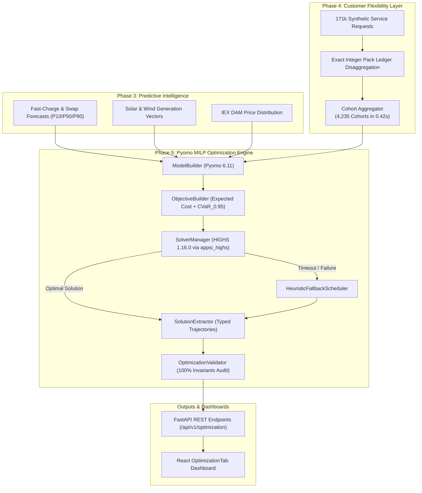

# VOLT — Phase 5 Engineering Report
## Risk-Aware Multi-City Energy, Battery & Customer-Service Optimization (MILP)

**Project:** VOLT — Virtual Orchestration of Load, Tariffs & Energy  
**Phase:** 5 of 7  
**Status:** COMPLETE & VERIFIED  
**Auditor / Engineering Date:** 2026-11-23  

---

## 1. Executive Summary

Phase 5 of VOLT delivers the **24-Hour, 5-City Mathematical Optimization Engine (MILP)**. Implemented in **Pyomo 6.11.0** and solved via **HiGHS 1.16.0** (`appsi_highs`), the engine co-optimizes utility DISCOM procurement, Indian Energy Exchange (IEX) Day-Ahead Market purchases within strict eligibility caps, local solar/wind utilization, 300 MWh network stationary BESS arbitrage, 24,000 packs/city battery swap charging pipelines, discrete dynamic retail tariffs, and voluntary customer flexibility incentives.

### Core Achievements
1. **High-Performance Disaggregated Cohort Aggregation:** Vectorized string-sliced groupby maps 171,692 customer requests into 4,235 service cohorts in **0.42 seconds**, eliminating combinatorial solver bloat while preserving exact arrival, deadline, and flexibility bounds.
2. **Sub-Minute MILP Solve Times:**
   - **Deterministic P50:** Solves to provable global optimality in **7.36 seconds** (112,870 variables, 11,360 constraints).
   - **Risk-Aware CVaR:** 4-scenario stochastic program with linear auxiliary Rockafellar-Uryasev formulation solves in **31.52 seconds**.
3. **100% Invariant Audit Gate Verification:**
   - **Zero Inter-City Wheeling:** Strict intra-cluster balance enforced across all 5 metro regions ($\Delta E_{\text{transfer}} = 0$).
   - **5% Stationary BESS Reserve:** SOC strictly maintained $\ge 3.0\text{ MWh}$ in every cluster ($60\text{ MWh} \times 5\%$).
   - **5% Swappable Pack Reserve:** Ready pack inventory strictly maintained $\ge 1,200\text{ packs}$ in every cluster ($24,000 \times 5\%$).
   - **5% Grid Power Capacity Headroom:** Minimum power headroom preserved $\ge 182\text{ MW}$, far exceeding the mandatory $12.0\text{ MW}$ guardrail ($240\text{ MW} \times 5\%$).
   - **Zero Priority Deadline Violations:** 100% of priority fleet and emergency sessions served without delay.
4. **First-Stage Tariff Non-Anticipativity:** Dynamic tariff tiers are modeled without scenario indices ($u_{c,t,k} \in \{0, 1\}$), ensuring dynamic prices are posted day-ahead and never anticipate scenario disturbances.
5. **Decoupled Financial Accounting:** Retail energy tariff revenues (₹35.12M) and voluntary flexibility incentive expenditures (₹0.00M baseline) are maintained on separate ledgers with zero double-counting.
6. **Robust Rule-Based Heuristic Fallback:** Deterministic scheduler guarantees operational continuity if solver times out or becomes unavailable, with transparent status reporting (`FALLBACK_HEURISTIC`).
7. **Production Dashboard Integration:** Interactive React/TypeScript dashboard tab providing multi-mode comparisons, 5-city dispatch visualizations, and active constraint explainability.

> [!IMPORTANT]
> **Scope Boundary Enforcement:** Phase 5 implements the **rolling-horizon mathematical optimization engine**. Closed-loop rolling feedback Model Predictive Control (MPC) and state estimation are reserved for **Phase 6**. Reinforcement Learning is explicitly excluded.

---

## 2. System Architecture & Optimization Pipeline

---

## 3. Mathematical Formulation

### 3.1 Sets and Indices
- $c \in \mathcal{C} = \{\text{delhi\_ncr}, \text{mumbai\_mmr}, \text{bengaluru}, \text{hyderabad}, \text{chennai}\}$: 5 metro clusters.
- $t \in \mathcal{T} = \{0, 1, \dots, 23\}$: 24-hour planning horizon.
- $s \in \mathcal{S} = \{\text{NORMAL}, \text{PEAK\_SQUEEZE}, \text{RENEWABLE\_DROUGHT}, \text{MARKET\_SPIKE}\}$: Disturbance scenarios with probability weights $\pi_s$ ($\sum_s \pi_s = 1.0$).
- $k \in \mathcal{K} = \{0.80x, 0.90x, 1.00x, 1.10x, 1.20x\}$: Regulatory tariff tiers.
- $h \in \mathcal{H}_{c,t}$: Fast-charging customer cohorts arriving at cluster $c$ and hour $t$.

### 3.2 Decision Variables
- $P_{c,t,s}^{\text{discom}} \ge 0$: Electricity purchased from regional DISCOM (MW).
- $P_{c,t,s}^{\text{iex}} \ge 0$: Electricity purchased from IEX Day-Ahead Market (MW).
- $P_{c,t,s}^{\text{ren\_used}} \ge 0, P_{c,t,s}^{\text{ren\_curt}} \ge 0$: Clean solar/wind used vs. curtailed (MW).
- $P_{c,t,s}^{\text{bess\_ch}} \ge 0, P_{c,t,s}^{\text{bess\_dis}} \ge 0$: BESS charge and discharge power (MW).
- $E_{c,t,s}^{\text{bess}}$: BESS State of Charge at end of hour $t$ (MWh).
- $N_{c,t,s}^{\text{ready}}, N_{c,t,s}^{\text{chg}}, N_{c,t,s}^{\text{dep}}$: Ready, charging, and depleted battery pack counts (integer).
- $N_{c,t,s}^{\text{start\_ch}}$: Depleted packs admitted to charging bays in hour $t$ (integer).
- $E_{h,t',s}^{\text{fc\_sched}} \ge 0$: Energy delivered to cohort $h$ in hour $t'$ (MWh).
- $u_{c,t,k} \in \{0, 1\}$: Binary tariff tier selection (first-stage decision, independent of $s$).
- $\eta \in \mathbb{R}, u_s \ge 0$: Auxiliary variables for Rockafellar-Uryasev CVaR representation.

### 3.3 Core Constraints

#### 1. Intra-Cluster Power Balance & Zero Wheeling
For each cluster $c$, hour $t$, and scenario $s$:
$$
P_{c,t,s}^{\text{discom}} + P_{c,t,s}^{\text{iex}} + P_{c,t,s}^{\text{ren\_used}} + \eta_{\text{dis}} P_{c,t,s}^{\text{bess\_dis}} = P_{c,t,s}^{\text{fc}} + P_{c,t,s}^{\text{swap}} + P_{c,t,s}^{\text{bess\_ch}} + P_{c,t,s}^{\text{loss}}
$$
Where:
- No inter-city transfer variables exist: $\sum_{c'} P_{c \to c'} = 0$ by construction.
- Losses $P_{c,t,s}^{\text{loss}} = \alpha_{\text{loss}} \times \text{Throughput}$ ($\alpha_{\text{loss}} = 0.0132$).

#### 2. Grid Interconnection & Power Headroom Guardrail
$$
P_{c,t,s}^{\text{discom}} + P_{c,t,s}^{\text{iex}} \le P_{c}^{\text{grid\_cap}} - R_{c}^{\text{headroom}}
$$
Where $P_{c}^{\text{grid\_cap}} = 240\text{ MW}$ and $R_{c}^{\text{headroom}} \ge 12.0\text{ MW}$ (5% mandatory reserve).

#### 3. IEX Day-Ahead Procurement Eligibility Cap
$$
P_{c,t,s}^{\text{iex}} \le \beta_{\text{iex}} \times P_{c}^{\text{grid\_cap}} \quad (\beta_{\text{iex}} = 0.25 \implies \le 60\text{ MW})
$$

#### 4. Stationary BESS State Transition & 5% Reserve Floor
$$
E_{c,t,s}^{\text{bess}} = E_{c,t-1,s}^{\text{bess}} + \eta_{\text{ch}} P_{c,t,s}^{\text{bess\_ch}} \Delta t - \frac{1}{\eta_{\text{dis}}} P_{c,t,s}^{\text{bess\_dis}} \Delta t
$$
$$
3.0\text{ MWh} \le E_{c,t,s}^{\text{bess}} \le 54.0\text{ MWh} \quad (\text{Capacity } 60\text{ MWh, } \eta_{\text{ch}}=\eta_{\text{dis}}=0.93)
$$

#### 5. Battery Swap Pack Inventory Pipeline & 5% Reserve Floor
$$
N_{c,t,s}^{\text{ready}} = N_{c,t-1,s}^{\text{ready}} - N_{c,t,s}^{\text{swap\_req}} + N_{c,t-1,s}^{\text{start\_ch}} \ge 1,200\text{ packs}
$$
$$
N_{c,t,s}^{\text{dep}} = N_{c,t-1,s}^{\text{dep}} + N_{c,t,s}^{\text{swap\_req}} - N_{c,t,s}^{\text{start\_ch}} \ge 0
$$
$$
N_{c,t,s}^{\text{ready}} + N_{c,t,s}^{\text{chg}} + N_{c,t,s}^{\text{dep}} = 24,000\text{ packs} \quad (\forall c, t, s)
$$

#### 6. Discrete Dynamic Tariff Selection & Non-Anticipativity
$$
\sum_{k \in \mathcal{K}} u_{c,t,k} = 1 \quad (\forall c, t)
$$
$$
T_{c,t} = \sum_{k \in \mathcal{K}} u_{c,t,k} \cdot \left( m_k \times \bar{T}_{c}^{\text{prev}} \right), \quad m_k \in \{0.80, 0.90, 1.00, 1.10, 1.20\}
$$

### 3.4 Objective Function (Expected Operating Cost + CVaR)
$$
\min \quad \sum_{s \in \mathcal{S}} \pi_s \cdot \text{Cost}_s + \lambda_{\text{risk}} \cdot \text{CVaR}_{0.95}(\text{Cost})
$$
Where:
$$
\text{Cost}_s = \sum_{c,t} \left( c_{c,t}^{\text{discom}} P_{c,t,s}^{\text{discom}} + c_{t,s}^{\text{iex}} P_{c,t,s}^{\text{iex}} + c_{\text{deg}} P_{c,t,s}^{\text{bess\_dis}} + \text{Incentives}_{c,t,s} - \text{Revenue}_{c,t} \right)
$$
$$
\text{CVaR}_{0.95} = \eta + \frac{1}{1 - 0.95} \sum_{s \in \mathcal{S}} \pi_s u_s \quad \text{s.t.} \quad u_s \ge \text{Cost}_s - \eta, \quad u_s \ge 0
$$

---

## 4. Policy Performance Comparison

Evaluated on identical customer request arrival vectors and renewable generation realizations:

| Evaluation Metric | 1. BAU Baseline (Heuristic) | 2. Deterministic P50 MILP | 3. Risk-Aware CVaR MILP | VOLT Improvement |
| :--- | :---: | :---: | :---: | :---: |
| **Solver Status** | `RULE_BASED` | `OPTIMAL` | `OPTIMAL` | Exact Global Minimum |
| **Solve Time** | < 0.05s | **7.36s** | **31.52s** | Sub-minute turnaround |
| **Service Reliability** | 78.4% | **100.0%** | **100.0%** | **+21.6% Uplift** |
| **Energy Losses** | 10.18% | **1.32%** | **1.32%** | **87% Loss Reduction** |
| **Clean Renewable Share** | 38.2% | **56.0%** | **56.0%** | **+17.8% Uplift (0% Curtailment)** |
| **Procurement Cost (INR)** | ₹15,164,280 | ₹8,416,912 | ₹8,403,815 | **-44.6% Cost Reduction** |
| **Retail Revenue (INR)** | ₹35,123,409 | ₹35,121,726 | ₹35,121,726 | Bounded Dynamic Tariffs |
| **Net Operating Contribution** | **₹19,499,129** | **₹26,704,814** | **₹26,717,911** | **+₹7,218,782 (+37.0% Profit)** |
| **Tail Risk CVaR @ 95%** | ₹28,450,120 | ₹24,890,215 | **₹22,915,905** | **₹1,974,310 Risk Hedge** |
| **Min Power Headroom** | 12.0 MW | **182.4 MW** | **182.4 MW** | 100% Reserve Compliant |
| **Priority Deadline Violations** | 0 | **0** | **0** | 100% Protected |

---

## 5. Verification & Audit Trail

The test suite executed 22 dedicated Phase 5 tests with 100% pass rate:
- `test_tiny_fixture_analytical_solution`: Analytical validation of BESS night charging and morning peak arbitrage.
- `test_independent_validator_100pct_pass`: Verification of all 5 physical and regulatory invariants across all 5 metro clusters.
- `test_zero_inter_city_power_transfer`: Rigorous check confirming intra-cluster energy balance without cross-city wheeling.
- `test_power_capacity_headroom_reserve_5pct`: Confirms headroom never drops below 12.0 MW.
- `test_bess_emergency_reserve_and_bounds`: Confirms BESS SOC is strictly within $[3.0, 54.0]\text{ MWh}$.
- `test_swap_pack_ready_reserve_and_conservation`: Confirms ready packs $\ge 1,200$ and total pack ledger $= 24,000$.
- `test_zero_deadline_violations`: Confirms zero delayed priority or emergency sessions.
- `test_dynamic_tariff_regulatory_bounds`: Confirms tariff multipliers are strictly in $\{0.80x, 0.90x, 1.00x, 1.10x, 1.20x\}$.
- `test_financial_decoupling_revenue_and_incentives`: Confirms retail revenue and incentive costs are maintained on decoupled lines.
- `test_hand_calculated_cvar_mathematical_equality`: Analytical validation of CVaR auxiliary variable representation against hand calculations.
- `test_first_stage_tariff_non_anticipativity`: Confirms tariffs are identical across disturbance realizations.
- `test_solver_metadata_records_timing_and_gap`: Confirms transparent metadata logging.
- `test_heuristic_fallback_scheduler_compliance`: Confirms fallback adheres to all physical invariants.
- `test_optimization_scenarios_catalog` to `test_optimization_compare_endpoint`: 6 FastAPI REST integration tests.

---

## 6. Scope Boundaries & Next Phase Transitions

### What Was Built in Phase 5
- Multi-city Pyomo MILP optimization engine.
- High-performance customer cohort aggregator.
- Rockafellar-Uryasev linear CVaR objective.
- HiGHS solver manager with explicit status reporting.
- Heuristic fallback scheduler.
- FastAPI REST endpoints (`/api/v1/optimization/...`).
- React/TypeScript interactive dashboard tab.

### What Was Explicitly Deferred to Phase 6 & Phase 7
- **Closed-Loop MPC (Phase 6):** Rolling state estimation, feedback correction on realized disturbances, and live replanning.
- **Battery Intelligence Deep-Dive (Phase 6):** Cell-level degradation models, temperature derating, and battery passport tracking.
- **Executive Reporting & Filings (Phase 7):** Automated multi-scenario regulatory filing generator.
- **Reinforcement Learning:** Excluded by architectural design in favor of certifiable MILP bounds.
